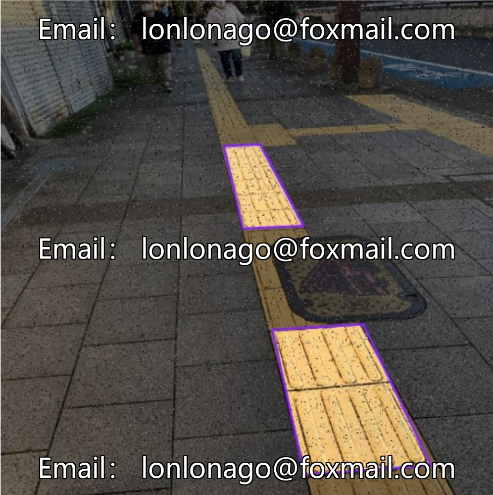
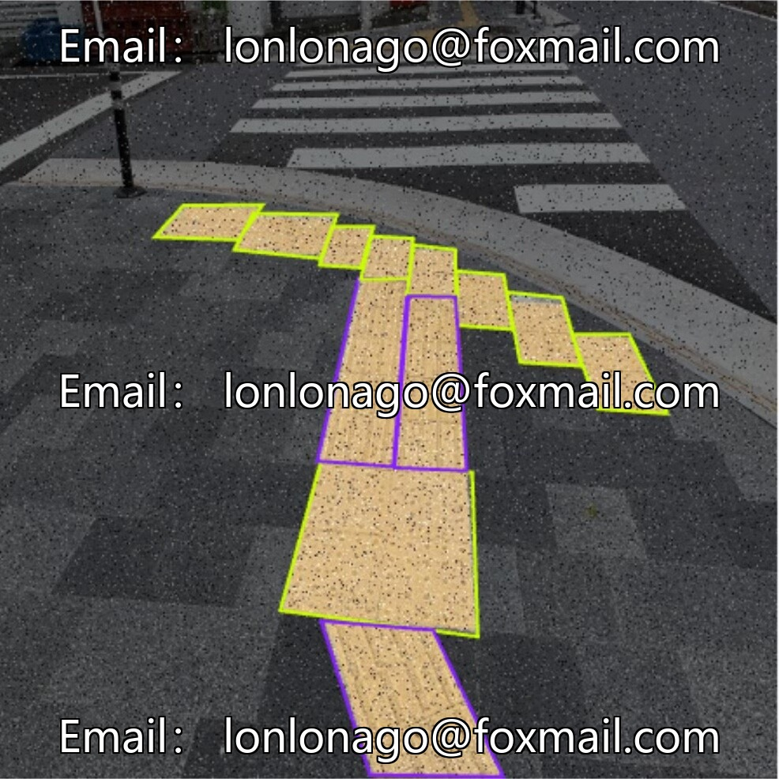
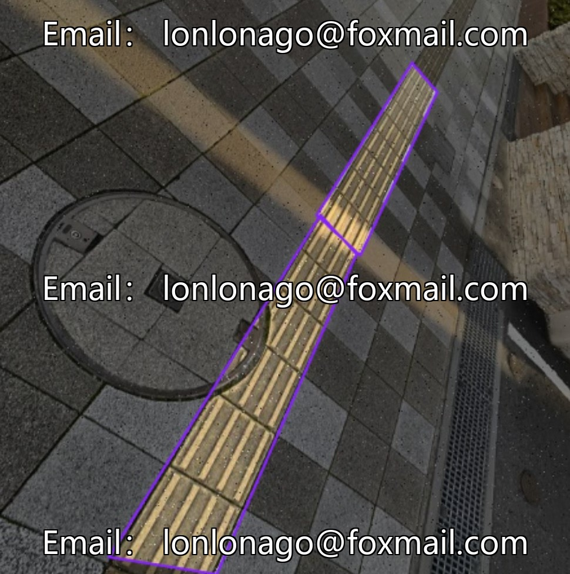
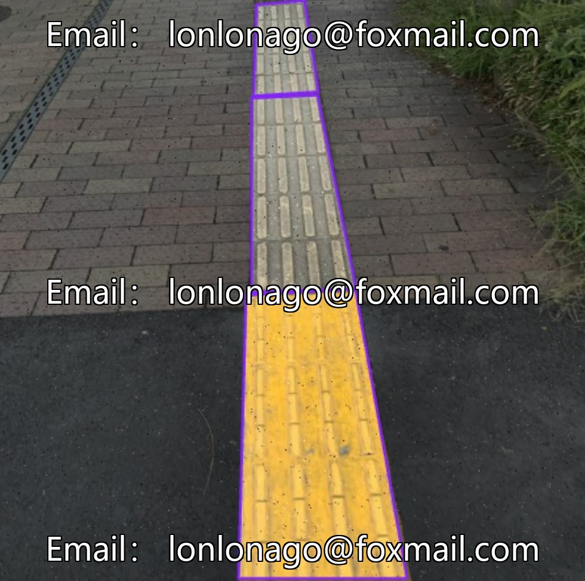

# Smart City Blind Path Image Segmentation Dataset - Subway Blind Path Segmentation

## Body

Smart City Blind Path Image Segmentation Dataset - Subway Blind Path Segmentation
1945 images, categorized into Go-Block and Stop-Block, suitable for training target detection models.
Formatted as image files, directly used for training, validation, and testing of models like YOLOv13, YOLO26 etc.
The dataset is highly targeted, with high model recognition accuracy, balancing training efficiency with performance.
Virtual material, once sold, will not be refunded.
Interested friends can click "I want" to proceed.

## Images

## Payment

Here is a pay link on Stripe ( https://buy.stripe.com/3cs8yP7sY87d0vu9AB ). Please contact me lonlonago@foxmail.com after funding $89, and I will send you a complete data files , thank you!

